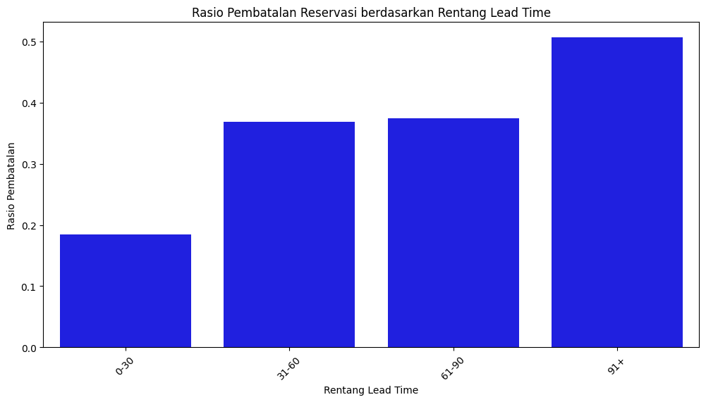
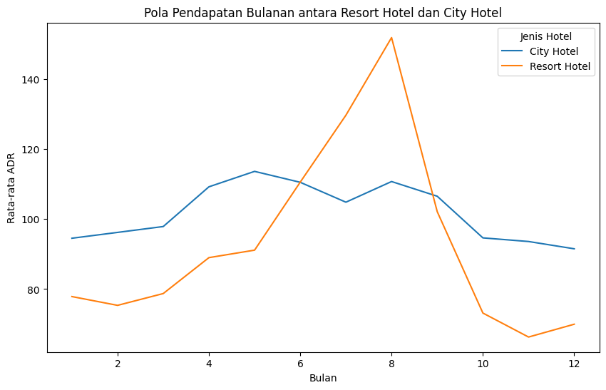
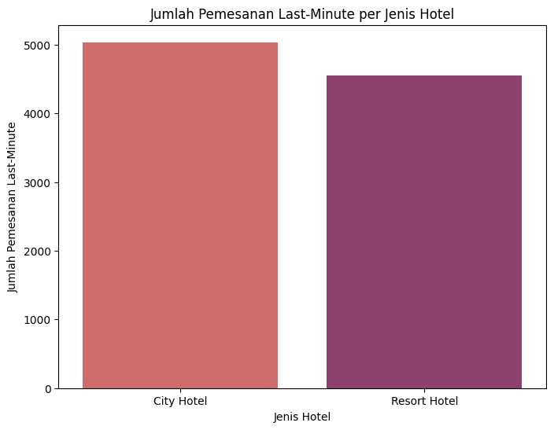

#  Analisis Data Reservasi Hotel: Manajemen Pembatalan & Optimasi Pendapatan

##  Deskripsi Proyek
Proyek ini bertujuan untuk menyelesaikan tantangan operasional dalam industri perhotelan, khususnya tingginya tingkat pembatalan, variasi *lead time*, dan optimalisasi *Average Daily Rate* (ADR). Melalui pendekatan *end-to-end data analytics*, proyek ini mengevaluasi kinerja dua jenis hotel (City Hotel dan Resort Hotel) untuk memberikan rekomendasi strategis berbasis data yang dapat meningkatkan stabilitas pendapatan dan efisiensi manajemen reservasi.

Catatan: *Raw data* tidak dilampirkan dalam repositori ini karena batasan ukuran file, namun dataset merupakan data historis pemesanan hotel (Hotel Booking Demand) publik yang telah dibersihkan dan dapat direproduksi menggunakan *script* yang tersedia.

##  Teknologi & *Tools*
* **Bahasa Pemrograman:** Python, SQL
* **Library Python:** Pandas, Matplotlib, Seaborn, SciPy
* **Visualisasi Tambahan:** Tableau *(Tautan Dashboard tersedia di bawah)*
* **Data Processing:** Data Cleaning, Imputasi Data, Deteksi & Penanganan Outlier (Metode IQR)
* **Analisis & Statistik:** *Exploratory Data Analysis* (EDA), A/B Testing (Uji T-test, KS Test, Levene Test)
* **Lainnya:** Pemodelan Proses Bisnis (BPMN)

##  Struktur Repositori
```text
├── data/
│   └── data_cleaned.csv         # Dataset hasil pembersihan (siap pakai)
├── notebooks/
│   └── EDA_and_AB_Testing.ipynb # Jupyter notebook (Data Prep, EDA, Statistik)
├── sql/
│   └── data_extraction.sql      # Kumpulan kueri SQL (CTE, Agregasi)
├── images/                      # Folder penyimpanan aset visualisasi
│   ├── rasio_pembatalan.png
│   ├── pola_pendapatan.png
│   └── pemesanan_last_minute.png
└── README.md
```
## Insight & Temuan Utama
1. Pola Pembatalan & Lead Time
City Hotel memiliki tingkat pembatalan yang lebih tinggi dibanding Resort Hotel. Rasio pembatalan berbanding lurus dengan panjangnya lead time; reservasi yang dilakukan jauh hari (91+ hari) memiliki kemungkinan batal tertinggi (mencapai ~51%).



2. Kinerja Pendapatan (ADR)
Melalui Uji A/B (T-statistic: 25.57, p-value < 0.05), terbukti ada perbedaan signifikan dalam ADR antara kedua hotel. City Hotel memiliki tren pendapatan yang relatif stabil sepanjang tahun, sedangkan Resort Hotel sangat fluktuatif dan bergantung pada musim (mencapai puncak pada bulan Agustus).



3. Tren Pemesanan Last-Minute
Pemesanan yang dilakukan secara mendadak atau mendekati hari kedatangan (<= 3 hari) lebih didominasi oleh pelanggan City Hotel (sekitar ~5.000 pemesanan) dibandingkan Resort Hotel (sekitar ~4.500 pemesanan).



## Rekomendasi Bisnis
1. Penyesuaian Kebijakan Pembatalan: Memperketat kebijakan fleksibilitas pembatalan atau memberlakukan sistem deposit untuk pemesanan dengan lead time panjang (>90 hari) guna menekan tingginya angka cancellation.

2. Strategi Harga Musiman (Dynamic Pricing): Resort Hotel perlu lebih responsif dalam menerapkan strategi harga untuk memaksimalkan margin di bulan ramai (Juli-Agustus) dan menawarkan paket promo di bulan sepi (Oktober-Januari).

3. Optimalisasi Promo Last-Minute: Mengingat tingginya angka pemesanan last-minute terutama di City Hotel, manajemen dapat merancang strategi upselling (seperti penawaran sarapan atau upgrade fasilitas) pada saat check-in untuk memaksimalkan pendapatan dari tamu yang memesan secara mendadak.
